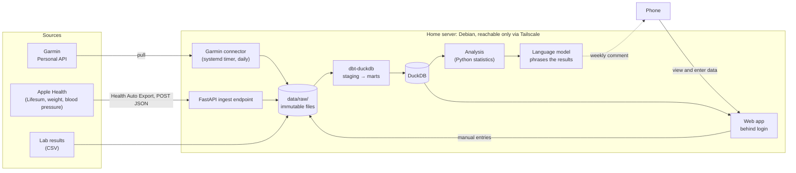
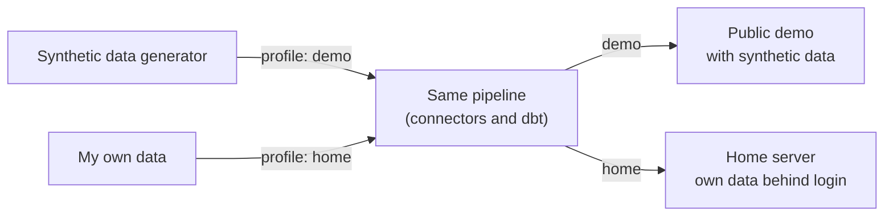

# Health X 

> **Status:** work in progress. This README describes the planned system. Parts that don't work yet are marked *(planned)*.

A personal health data platform that brings sleep, activity, nutrition, self-entered measurements and lab results into one place. The goal is to find out which factors actually affect my recovery and well-being. Python computes the statistics, and a language model turns the findings into short comments.

<!-- TODO: Write 2–3 sentences in your own words: why you built this and what question you want answered. This is the most important part of the README — don't let anyone else write it. -->

## Data flow



Two principles shape the design:

1. **Raw data is immutable.** Every source, including the web form, first writes its data as files under `data/raw/`. The database can be rebuilt from them at any time, and nothing writes to DuckDB outside the pipeline.
2. **Code computes, the language model narrates.** The model only receives precomputed summaries, never raw data. Every number in a comment must be traceable to the analysis output.

## Two environments



The public demo and my own setup run the same code. Only the data source and the settings profile change. Real health data never ends up in this repository or in the public demo.

## Components

| Layer | Choice | Status |
| --- | --- | --- |
| Server | Debian machine at home, Tailscale, restic backups | *(planned, phase 0)* |
| Python tooling | uv, ruff, pre-commit | *(planned, phase 0)* |
| CI | GitHub Actions, ruff, sqlfluff, pytest, dbt build | *(planned, phase 0)* |
| Garmin | Garmin Personal API | *(planned, phase 1)* |
| Storage and transforms | DuckDB, dbt-core, dbt-duckdb | *(planned, phase 1)* |
| Scheduling | systemd timer | *(planned, phase 1)* |
| Web app | Streamlit with OpenID Connect login | *(planned, phase 2)* |
| Lab results | CSV, pydantic validation, LOINC codes | *(planned, phase 3)* |
| Apple Health | Health Auto Export and a FastAPI ingest endpoint | *(planned, phase 4)* |
| Analysis | Python statistics, weekly report | *(planned, phase 5)* |
| AI comments | Language model, phone notification | *(planned, phase 6)* |

## Repository layout

```text
.
├── connectors/       # one connector per data source
├── transform/        # dbt project: staging and mart models
├── app/              # web app
├── analysis/         # statistics and weekly report
├── synthetic/        # synthetic data generator
├── data/             # NOT under version control
│   └── raw/          # immutable raw files, by source
├── docs/
│   └── decisions/    # architecture decision records
└── tests/
```

## Getting started *(planned)*

The goal is a demo that runs with a single command:

```bash
git clone <repo-url>
cd <repo>
make demo   # generates synthetic data, runs the pipeline and starts the web app
```

## Privacy

- Real data lives only on the home server, in an encrypted directory. The server is reachable only via Tailscale.
- `data/` and `.env` are in `.gitignore`. The repository and its history are scanned with gitleaks before every release.
- The public demo uses synthetic data only.
- The language model receives summaries only, never individual measurements.
- Results are observations from one person's data, not medical conclusions.

## Decisions

Key design choices and their reasoning are recorded in [`docs/decisions/`](docs/decisions/).

<!-- TODO: Link each decision record here as you write them. -->

## Roadmap

- [ ] Phase 0: foundation, CI and a hardened server
- [ ] Phase 1: Garmin data refreshes every morning
- [ ] Phase 2: web app, login and manual data entry
- [ ] Phase 3: lab results and blood donation analysis
- [ ] Phase 4: Apple Health and nutrition
- [ ] Phase 5: analysis and weekly report
- [ ] Phase 6: AI comments and notifications

## License

<!-- TODO: Pick a license (e.g. MIT) and add a LICENSE file. -->